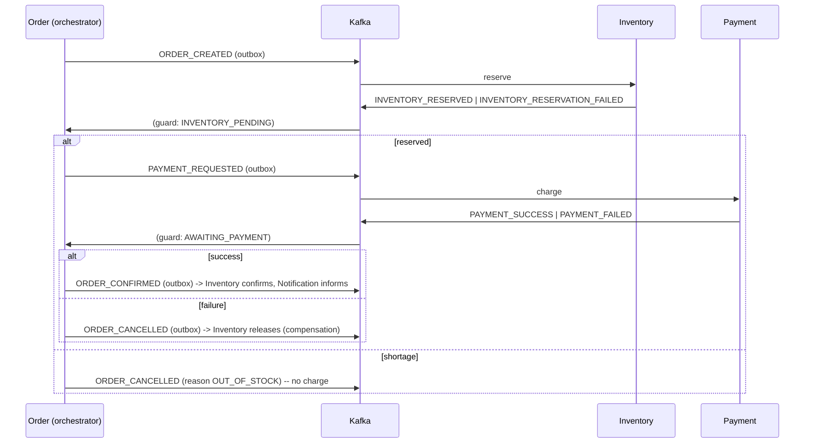

# ShopFlow — System Design

Event-driven e-commerce backend: 8 Spring Boot 3 / Java 17 services, PostgreSQL, Redis, Apache
Kafka, an orchestrated Saga for the order workflow, Docker Compose, Kubernetes, GitHub Actions.

This is the consolidated design. Deeper docs: [conventions](conventions.md) ·
[event catalog](events/event-catalog.md) · [kafka & saga](kafka-and-saga.md) ·
[security](security.md) · [observability](observability.md) · [performance](performance.md) ·
[failure scenarios](failure-scenarios.md) · [ADRs](adr/README.md).

---

## 1. Overall architecture

```mermaid
flowchart TB
  Client --> GW["API Gateway (reactive)\nrouting · edge JWT · rate limit · correlation-id"]
  subgraph Sync["Synchronous plane (REST)"]
    USER[User]:::db
    PROD[Product]:::db
    CART[Cart]:::redis
    ORD[Order + Saga orchestrator]:::db
    INV[Inventory]:::db
    PAY[Payment]:::db
    NOTIF[Notification]:::db
  end
  subgraph Async["Asynchronous plane (Kafka)"]
    OE([order-events]); IE([inventory-events]); PE([payment-events]); NE([notification-events]); DLT[["*.DLT"]]
  end
  GW --> USER & PROD & CART & ORD
  ORD -. REST: validate/clear cart .-> CART
  CART -. REST: product exists/price .-> PROD
  PROD -. REST: create stock row .-> INV
  ORD --> OE --> INV & NOTIF
  INV --> IE --> ORD
  ORD --> PE --> PAY --> PE --> ORD
  ORD --> OE --> NOTIF
  PROD -. cache-aside .-> R[(Redis)]
  CART -. hash+TTL .-> R
  GW -. token bucket .-> R
  classDef db fill:#e8f0fe; classDef redis fill:#fde8e8
```

**REST when the caller can't proceed without the answer** (client↔gateway↔services; cart validation;
price snapshot; Product→Inventory stock-row creation). **Kafka when work can happen later, must be
durable, may need retry/replay, or fans out** (the whole order Saga; notifications).

## 2. Service responsibilities

| Service | Owns | Port | Store |
|---|---|---|---|
| API Gateway | routing, edge JWT verification, `X-User-*` injection/stripping, rate limiting, correlation IDs, CORS, secure headers | 8080 | — (reactive) |
| User | identity, credentials, roles, refresh-token lifecycle, profile; issues JWTs | 8081 | PostgreSQL |
| Product | catalogue (products, categories, prices), search/filter/sort, image URL | 8082 | PostgreSQL + Redis cache |
| Cart | the transient cart (add/update/remove/get/clear), pricing | 8083 | **Redis only** |
| Order | order aggregate, lifecycle state machine, history, **Saga orchestrator**, outbox, watchdog | 8084 | PostgreSQL |
| Inventory | stock per product, atomic reserve/release/confirm, oversell prevention | 8085 | PostgreSQL |
| Payment | simulated charges (idempotent), payment status, refunds | 8086 | PostgreSQL |
| Notification | consume events → simulated email/SMS, history, retry | 8087 | PostgreSQL |

## 3. Database ownership

One PostgreSQL instance, **one database per service** (`shopflow_user`, `_product`, `_order`,
`_inventory`, `_payment`, `_notification`; Cart has none). Each service connects only to its own DB
with its own credentials. **No cross-service joins.** FKs inside a boundary only. Schema by **Flyway**
migrations checked into each service; Hibernate runs `ddl-auto=validate`. Money is `NUMERIC(12,2)`.
Orders **snapshot** product name + price at creation, so a later price change doesn't rewrite history.

## 4. Kafka architecture

4 business topics (`order-events`, `inventory-events`, `payment-events`, `notification-events`),
3 partitions each, + a `.DLT` per topic. Key = `orderId` for order/inventory/payment (per-order
ordering while different orders parallelise); `userId` for notification. Envelope:
`{eventId, eventType, eventVersion, timestamp, correlationId, source, payload}`. At-least-once;
offsets committed **after** each handler (`RECORD` ack); retry 1/2/4s then DLT; malformed envelope →
DLT immediately. Shared setup + `NewTopic` beans live in `shopflow-common`
([ADR-0009](adr/0009-kafka-support-and-outbox.md)).

## 5. Redis caching

- **Product detail**: cache-aside (`product:{id}`), 10 min TTL **± 10% jitter**, **delete-on-write**.
  Redis down → DB fallback. Hit/miss metered. Listings not cached.
- **Cart**: Redis is the *source of truth* (a hash per user, sliding 14-day TTL) — not a cache
  ([ADR-0004](adr/0004-cart-redis-only.md)). Redis down → cart `503`.
- **Rate limiting**: Redis token bucket at the gateway, keyed by user id (post-auth) or IP.

## 6. Order lifecycle

```
PENDING → INVENTORY_PENDING → AWAITING_PAYMENT → CONFIRMED → REFUNDED
   └───────────── └────────────── └──────────────> CANCELLED
any state ─────────────────────────────────────────> FAILED
```

`OrderStateMachine` (static, no Spring) is the single source of legal transitions;
`Order.transitionTo` guards every change; every transition writes an `order_status_history` row
(from, to, reason, correlationId, timestamp). `POST /api/orders` returns **`202 Accepted`** with
`PENDING`; the client polls `GET /api/orders/{id}`.

## 7. Saga workflow (orchestration)

Order Service orchestrates. Inventory is reserved **before** payment, so "charged but no stock"
cannot happen.



**Consistency model**: ACID *within* a service; **eventual consistency** across services.
Compensations produce a business-equivalent "as if it never happened" state (stock restored, order
`CANCELLED`, no payment captured) — no 2PC, no distributed locks. Guarantee: a customer is **never
charged for an order that isn't `CONFIRMED`**, and stock is **never permanently lost** to a cancelled
order.

## 8. Failure handling

See [failure-scenarios.md](failure-scenarios.md). Key mechanisms: retry + **dead-letter topics**;
the **transactional outbox** in Order Service (no dual-write gap on the order write path); a
**watchdog** that cancels orders stuck pre-confirmation past 5 minutes (triggering normal
compensation); idempotent consumers everywhere.

## 9. Idempotency

- **HTTP**: `Idempotency-Key` header → `idempotency_key` table (Order); the order id is reserved
  *before* the order row, so the unique constraint is the real guard and a replay returns the original.
- **Kafka consumers**: `processed_event(event_id PK)` per service, written in the handler's
  transaction (`existsById` + `save`, no flush) — a duplicate delivery is a clean no-op.
- **State guards**: an outcome event for the wrong current status is logged and ignored (late /
  re-ordered events are harmless).
- **Domain**: `payment.order_id`, `inventory_reservation.order_id`, `notification(event_id, channel)`,
  `product.sku`, `app_user.email` are UNIQUE.

## 10. Security

JWT HS256 access tokens (15 min) issued by User Service, verified at the gateway **and** in each
service (defence in depth). Opaque, hashed, **rotating** refresh tokens with **reuse detection**
([ADR-0007](adr/0007-refresh-token-rotation.md)). BCrypt (cost 12) + dummy-hash timing mitigation.
Roles `CUSTOMER` / `ADMIN`; request-matcher + `@PreAuthorize` + ownership checks. Gateway strips
inbound `X-User-*`, injects verified ones. Secrets from env / K8s Secrets / Secrets Manager. Full
posture and known limitations: [security.md](security.md).

## 11. Observability

Structured JSON logs (correlation id + user id on every line, under the `docker`/`prod` profile).
Micrometer → `/actuator/prometheus` on all 8; Prometheus scrapes; Grafana **ShopFlow Overview**
dashboard. Correlation IDs flow HTTP header → Kafka envelope → every log line — paste one id into a
log query to reconstruct a failed order end to end. [observability.md](observability.md) + runbooks.

## 12. Deployment

- **Local**: `docker compose up` — 8 services + Postgres + Redis + Kafka + Prometheus + Grafana,
  health-gated, one command. `scripts/smoke.sh` verifies the happy path.
- **Kubernetes**: `kubectl apply -k deploy/k8s/base` — kustomize base with ConfigMap/Secret,
  single-replica infra (swap for managed in prod), 8 Deployments + Services, Ingress, HPAs.
- **AWS**: [deploy/aws/README.md](../../deploy/aws/README.md) — a lowest-cost single-EC2 path and a
  Fargate + RDS + ElastiCache + MSK path with an IAM/CloudWatch/teardown checklist.
- **CI/CD**: [cicd.md](cicd.md) — GitHub Actions: fast unit job → Testcontainers integration job;
  matrix image publish to GHCR on `main`/tags.

## 13. Scaling strategy

Every service is **stateless** (state in Postgres/Redis/Kafka) → scale horizontally and roll freely.
Kafka consumer groups scale to the partition count (3). HPAs on gateway + order-service (CPU 70%).
DB is the first bottleneck: pagination + indexes + caching keep read load off it; connection-pool
sizing must respect `replicas * pool_size < max_connections`. Read replicas / partitioning are
future work, gated on measurement.

## 14. Trade-offs

| Chose | Over | Because | Cost |
|---|---|---|---|
| Orchestrated Saga | Choreography | flow is visible in one place + `order_status_history` | Order Service carries more logic (kept stateless + watchdog) |
| Monorepo | Polyrepo | one clone, one `mvn verify`, atomic contract changes | no independent release |
| Thin shared lib + auto-config | Copy-paste / no sharing | one impl of the envelope, error body, security, Kafka setup | build-time coupling (kept business-logic-free) |
| Outbox in Order only | Outbox everywhere / nowhere | correctness where the sync HTTP path emits the first event; scope | small dual-write window in Inventory/Payment/Notification (watchdog covers it) |
| `202` + poll | Block the HTTP thread for the whole Saga | honest async shape, frees the thread | client must poll |
| Redis-only cart | Postgres-backed cart | matches the data (ephemeral, key-access) | a Redis data loss loses carts (documented) |
| Simulated payment / email | Real gateway / SMTP | Phase-1 non-goal; keeps the project free and deterministic | not a real integration |
| No service discovery | Eureka | K8s/Compose DNS already does it | a config change to add/move a service |
