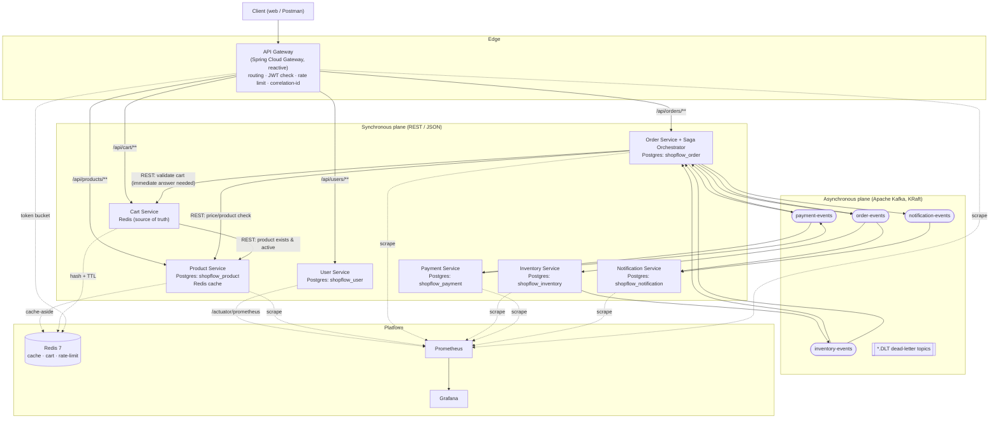
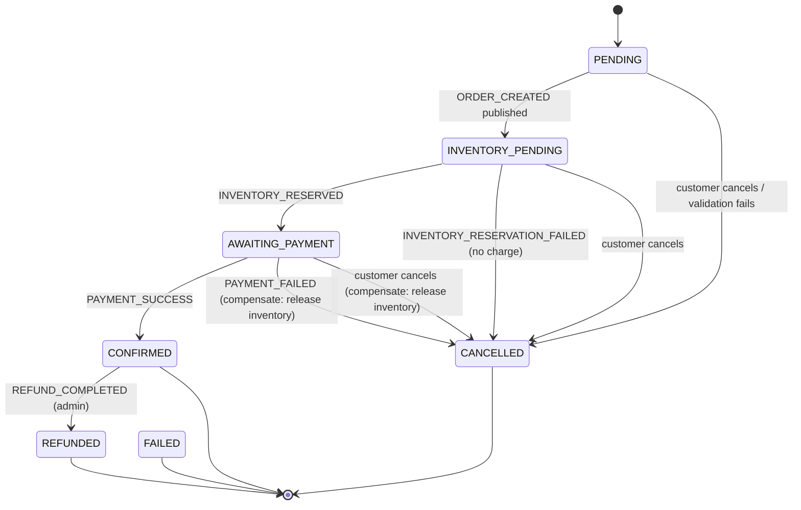
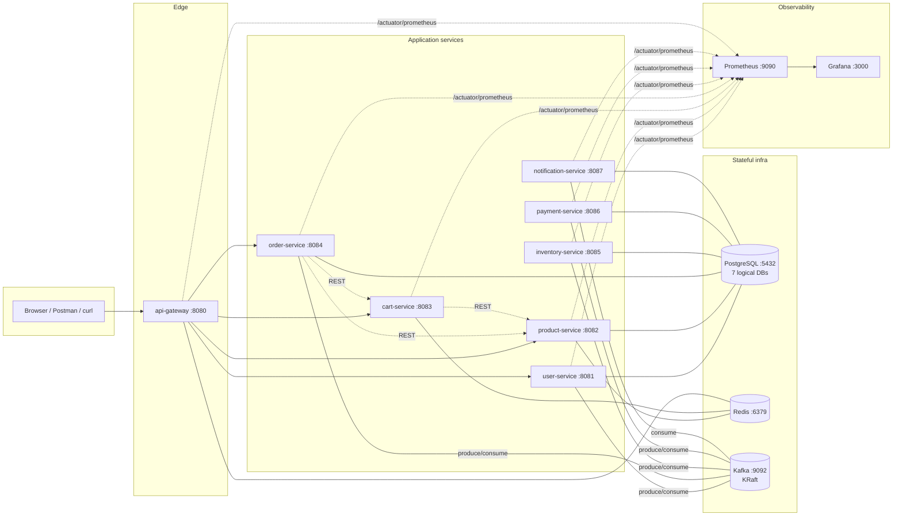
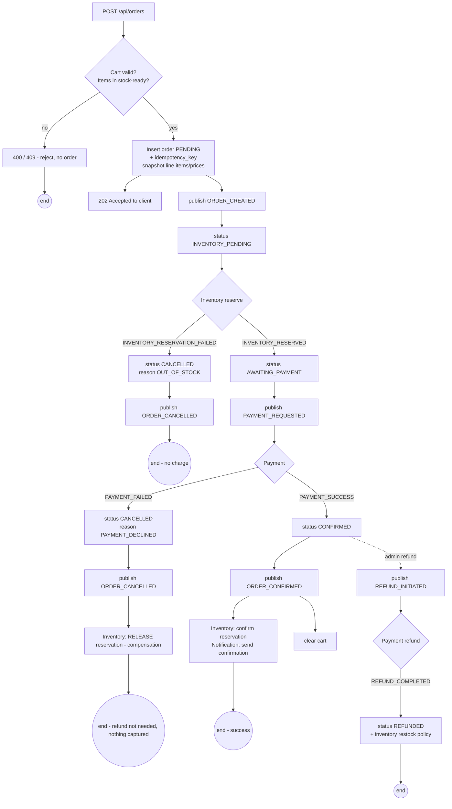
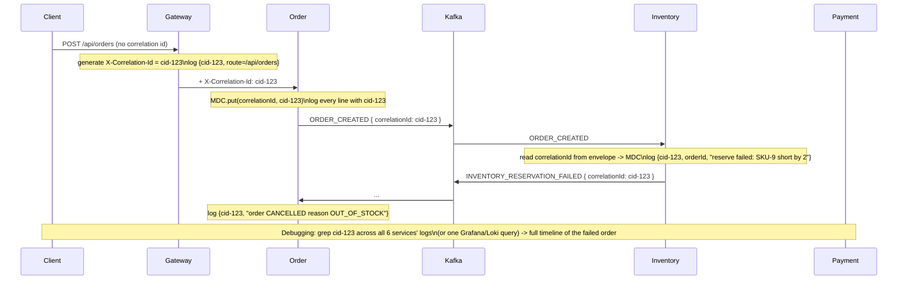
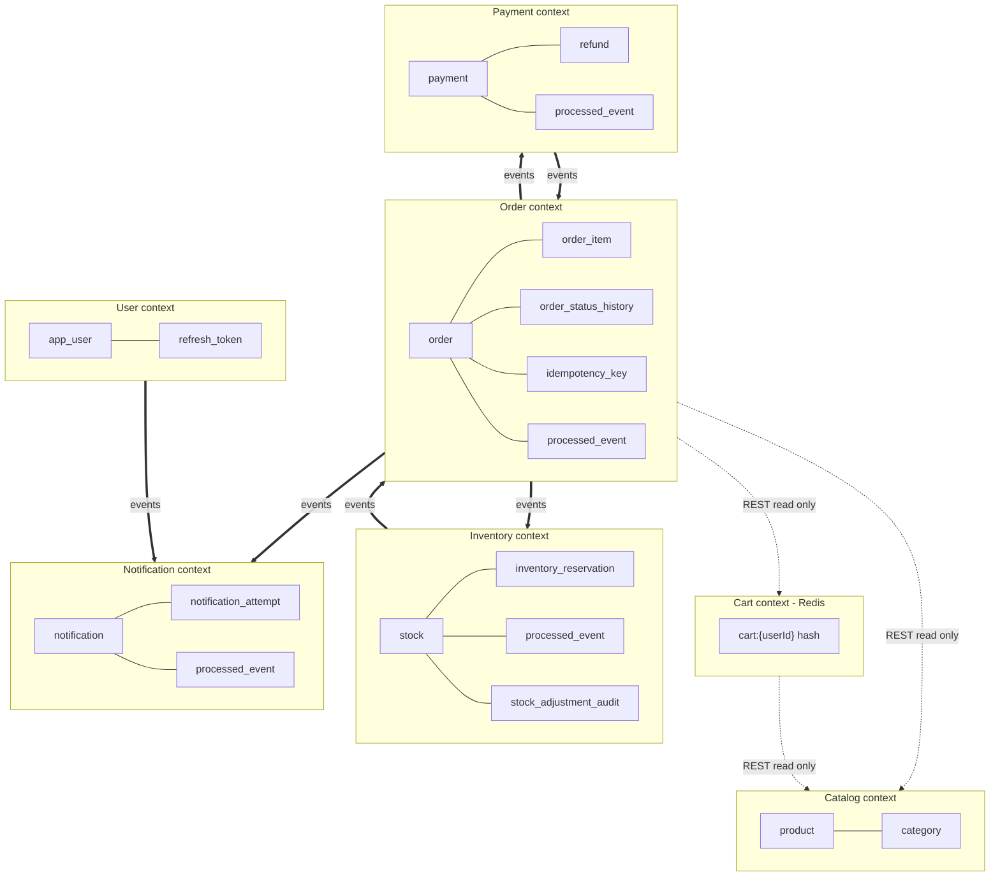

# ShopFlow — Phase 1: Requirements & Architecture

> Event-driven e-commerce backend. Portfolio project targeting Junior/Associate Java Backend Engineer roles (India market).
> **Status:** Phase 1 — design only, no code. Awaiting approval before Phase 2.

---

## 0. Decisions locked in Phase 1

These were explicitly chosen and drive every later phase:

| Decision | Choice | One-line reason |
|---|---|---|
| Saga coordination | **Orchestration** — Order Service owns the state machine | Centralised, debuggable, visualisable; best way to *show* the Saga pattern |
| Cart storage | **Redis only**, with TTL | Carts are inherently ephemeral; keeps the cache-vs-store story clean |
| API Gateway | **Spring Cloud Gateway (reactive)** | Mainstream choice interviewers expect; only the gateway is reactive |
| Service discovery | **Static config + DNS** (Docker Compose / Kubernetes) | No Eureka; avoids an extra component that K8s already gives us |
| Repo layout | **Monorepo**, one Maven module per service + one thin shared library | Easiest to run, review, and CI for a solo project |
| Auth | **JWT** access + refresh tokens, validated at the Gateway and re-validated in each service | Stateless, standard, cheap |
| Consistency | **Eventual consistency** across services; ACID only *within* a service | Honest model for distributed systems; no 2PC, no cross-service transactions |

Open questions for you at the end of this document (Section 16).

---

## 1. Complete functional requirements

### Actors

| Actor | Description |
|---|---|
| **Guest** | Unauthenticated visitor. Can browse/search products only. |
| **Customer** | Registered user with `ROLE_CUSTOMER`. Full shopping lifecycle. |
| **Admin** | Staff user with `ROLE_ADMIN`. Catalogue + inventory + operational visibility. |
| **System** | Kafka consumers / schedulers acting on events (no human). |

### FR — User Service

| ID | Requirement | Notes |
|---|---|---|
| U-1 | Register with email + password | Email unique; password hashed with BCrypt (cost 10–12). Email verification is **off** for the demo (documented). |
| U-2 | Login → returns access token + refresh token | Access token ~15 min, refresh token ~7 days. |
| U-3 | Refresh access token using a valid refresh token | Refresh tokens are rotated and stored server-side (Postgres) so they can be revoked. |
| U-4 | Logout → revoke refresh token | Access token still valid until expiry (accepted trade-off; short TTL limits blast radius). |
| U-5 | Get / update own profile (name, phone, address) | Customer can only touch their own record. |
| U-6 | Roles assigned at registration | First user *may* be bootstrapped as ADMIN via config; normally CUSTOMER. |
| U-7 | Publish `USER_REGISTERED` event | Consumed by Notification (welcome message). |

### FR — Product Service

| ID | Requirement | Notes |
|---|---|---|
| P-1 | Admin: create product (name, description, price, category, SKU, active flag) | SKU unique. |
| P-2 | Admin: update product | Price changes do **not** retroactively change existing orders (orders snapshot price). |
| P-3 | Admin: deactivate product (soft delete via `active=false`) | Hard delete not exposed; keeps referential history sane. |
| P-4 | Public: list products with **pagination, sorting, filtering** | Filter by category, price range, `active=true`, text search on name/description. |
| P-5 | Public: get product by id | 404 if not found or inactive (inactive hidden from customers, visible to admin). |
| P-6 | Category management (list; create/update by admin) | Flat categories in Phase 1 (no tree) to avoid over-engineering. |
| P-7 | Publish `PRODUCT_CREATED` event | Consumed by Inventory to auto-create a stock row with 0 quantity. |
| P-8 | Read-through cache of product detail + first page of listings in Redis | Cache-aside; invalidate on update/deactivate. |

### FR — Cart Service

| ID | Requirement | Notes |
|---|---|---|
| C-1 | Add item (productId, quantity) to the caller's cart | Validates the product exists + is active (REST call to Product Service). |
| C-2 | Update item quantity | Quantity 0 → remove. |
| C-3 | Remove item | |
| C-4 | Get cart (items, per-line price snapshot, totals) | Price is re-fetched/refreshed on read so totals are current. |
| C-5 | Clear cart | Also called by Order Service after a successful order. |
| C-6 | Cart TTL | Sliding TTL (e.g. 14 days) refreshed on every write. Documented: cart is not durable. |
| C-7 | One active cart per user | Key = `cart:{userId}`. |

### FR — Order Service (Saga orchestrator)

| ID | Requirement | Notes |
|---|---|---|
| O-1 | Create order from the caller's cart | Requires `Idempotency-Key` header. Validates cart via REST, snapshots line items + prices, creates `PENDING` order, starts the Saga. |
| O-2 | Get order by id (owner or admin) | |
| O-3 | List the caller's orders (paginated) | Admin can list all orders with filters (status, date range, userId). |
| O-4 | Cancel order (customer) — only while `PENDING`/`AWAITING_PAYMENT` | After `CONFIRMED`, cancellation is a separate refund flow (admin-triggered in Phase 1). |
| O-5 | Order state machine + full status history table | Every transition writes an `order_status_history` row with reason + correlationId + timestamp. |
| O-6 | Drive the Saga: reserve inventory → take payment → confirm / compensate | See Section 10. |
| O-7 | Emit `ORDER_CREATED`, `ORDER_CONFIRMED`, `ORDER_CANCELLED`, `REFUND_INITIATED` | Partition key = `orderId`. |
| O-8 | Idempotent Kafka consumers for inventory + payment results | `processed_events` table keyed by `eventId`. |

### FR — Inventory Service

| ID | Requirement | Notes |
|---|---|---|
| I-1 | Maintain stock per SKU/productId (`total`, `available`, `reserved`) | Row auto-created on `PRODUCT_CREATED`; admin can set/adjust quantities. |
| I-2 | Reserve inventory for an order (consume `ORDER_CREATED`) | Atomic conditional decrement; prevents overselling. Idempotent per `orderId`. |
| I-3 | Release reservation (consume `ORDER_CANCELLED` / payment failure) | Compensating action; returns quantity to `available`. Idempotent. |
| I-4 | Confirm reservation (consume `ORDER_CONFIRMED`) | Moves `reserved` → shipped/decremented from `total`. Idempotent. |
| I-5 | Emit `INVENTORY_RESERVED` / `INVENTORY_RESERVATION_FAILED` / `INVENTORY_RELEASED` | Partition key = `orderId`. |
| I-6 | Admin: view stock, adjust stock | Adjustments are audited. |
| I-7 | Concurrency-safe under parallel reservations for the same SKU | See Section 12 (concurrency) — atomic `UPDATE ... WHERE available >= qty` + `@Version`. |

### FR — Payment Service

| ID | Requirement | Notes |
|---|---|---|
| PM-1 | Process a payment request for an order (consume `PAYMENT_REQUESTED`) | **Simulated**: deterministic rule + configurable failure rate (e.g. amount ending in `.13` always fails; otherwise `PAYMENT_FAIL_RATE` random). |
| PM-2 | Idempotent: one payment per `orderId` | `payment(order_id)` UNIQUE. Duplicate request → return the existing outcome, never double-charge. |
| PM-3 | Emit `PAYMENT_INITIATED`, `PAYMENT_SUCCESS`, `PAYMENT_FAILED` | Partition key = `orderId`. |
| PM-4 | Get payment status by orderId (owner or admin) | |
| PM-5 | Refund simulation (consume `REFUND_INITIATED`, or admin endpoint) | Emits `REFUND_COMPLETED`. Idempotent per `orderId`. |
| PM-6 | No real gateway | Explicitly out of scope. |

### FR — Notification Service

| ID | Requirement | Notes |
|---|---|---|
| N-1 | Consume `USER_REGISTERED`, `ORDER_CONFIRMED`, `ORDER_CANCELLED`, `PAYMENT_FAILED`, `REFUND_COMPLETED` | |
| N-2 | Simulate email/SMS (log + persist a `notification` row with status) | No real SMTP/SMS provider. |
| N-3 | Notification history (query by userId, admin) | |
| N-4 | Retry failed notifications | Bounded retries with backoff; exhausted → `notification-events.DLT` + status `FAILED`. |
| N-5 | Idempotent per `(eventId, channel)` | Don't send the same message twice for a redelivered event. |

### FR — API Gateway

| ID | Requirement | Notes |
|---|---|---|
| G-1 | Single entry point; route `/api/{service}/**` to the right service | Routes from config. |
| G-2 | Validate JWT on protected routes; reject with `401` early | Public routes: register, login, refresh, product browse, swagger, actuator health. |
| G-3 | Forward identity downstream | Adds `X-User-Id`, `X-User-Roles` headers after verifying the token; strips any client-supplied copies. |
| G-4 | Generate / propagate `X-Correlation-Id` | Create if absent; echo on response; put in logs. |
| G-5 | Rate limiting | Redis-backed token bucket per client (by user id, else IP). Configurable limits. |
| G-6 | Centralised error shape for gateway-level failures | Same JSON error contract as services (Section 11 in the master spec). |
| G-7 | CORS + secure headers | Configurable allowed origins; `X-Content-Type-Options`, `X-Frame-Options`, HSTS (when TLS), etc. |

### Cross-cutting functional requirements

- Consistent error response body on every 4xx/5xx (timestamp, status, error code, message, path, correlationId).
- OpenAPI/Swagger UI per service, aggregated behind the gateway.
- `/actuator/health`, `/actuator/info`, `/actuator/prometheus` on every service.
- Structured JSON logs with `correlationId`, `service`, `userId` (never the token, never the password, never PAN-like data).

---

## 2. Non-functional requirements

| Category | Target / Statement | How we'll meet it |
|---|---|---|
| **Performance — latency** | p95 < 200 ms for cached reads (product detail, cart), p95 < 500 ms for order creation *accepting the order* (Saga completes asynchronously) | Redis cache-aside, DB indexes, pagination, connection pooling (HikariCP), no N+1 (fetch joins / `@EntityGraph`) |
| **Performance — throughput** | Demonstrate ~100–300 order requests/min sustained on a laptop / small VM | Kafka partitions (3 per topic), stateless services, horizontal scaling |
| **Scalability** | Every service horizontally scalable; no sticky sessions | Stateless JWT auth, state in Postgres/Redis/Kafka, consumer groups scale to partition count |
| **Availability** | Graceful degradation, not five-nines | Circuit breakers / timeouts on REST calls; Kafka decouples write path; health checks + K8s restarts |
| **Consistency** | Eventual consistency across services; read-your-writes within a service | Saga + compensations; idempotent consumers; `order` is the source of truth for order state |
| **Durability** | No committed order/payment/inventory change is lost | Postgres (ACID) per service; Kafka `acks=all`, `min.insync.replicas` documented; outbox pattern optional (Section 16) |
| **Security** | OWASP-aware; least privilege; no secrets in code | BCrypt, short-lived JWT, RBAC, input validation, secrets via env/K8s Secrets, TLS at the edge |
| **Observability** | Any failed order is explainable end-to-end in < 5 min | Correlation IDs on every log + event; Prometheus metrics; Grafana dashboards; DLT inspection |
| **Resilience** | Survives a dependency being down without data corruption | Retries with backoff + jitter, DLT, idempotency, timeouts, bulkheads (separate thread pools where relevant) |
| **Portability** | Runs with one command locally; deployable to K8s and AWS | Docker + Docker Compose; 12-factor config; K8s manifests; AWS notes |
| **Maintainability** | SOLID, clean architecture, DTOs, no god classes | Layered packages, per-service ownership, thin shared lib limited to cross-cutting concerns |
| **Cost** | Free to develop; cheap to demo on AWS | Everything local in Compose; AWS path uses one small EC2 or ECS Fargate + RDS `db.t4g.micro` |
| **Testability** | Critical paths covered by unit + integration tests; CI fails on test failure | JUnit 5, Mockito, MockMvc, Testcontainers (Postgres/Kafka/Redis), GitHub Actions |
| **Compatibility** | Java 17+, Spring Boot 3.x, PostgreSQL 16, Redis 7, Kafka (KRaft mode, no ZooKeeper) | Pinned versions in a root BOM/parent |

Explicit **non-goals** for this project: real payment gateway, real email/SMS, multi-region, multi-currency FX, product recommendation/ML, search engine (Elasticsearch) — Postgres full-text/`ILIKE` is enough at this scale, and adding Elasticsearch would violate the "no tech just to look impressive" rule.

---

## 3. Service boundaries

Principle: **a service owns a business capability and its data. No other service reads or writes that data directly.** Boundaries follow *what changes together* and *who is the source of truth*.

| Service | Owns (source of truth) | Does NOT own | Why it's a separate service |
|---|---|---|---|
| **User** | Identity, credentials, roles, refresh tokens, profile | Orders, carts | Different change cadence + security isolation; auth is reused by everyone |
| **Product** | Catalogue: products, categories, prices | Stock levels, orders | Read-heavy, cache-heavy, admin-write; scales independently from the write path |
| **Cart** | The transient shopping cart | Prices (snapshots from Product), stock | Ephemeral, Redis-shaped, extremely high write rate, no reporting needs — a poor fit for the same DB as orders |
| **Order** | Orders, order line items, order status history, Saga state | Stock, payment records, catalogue | It's the transactional heart + the Saga orchestrator; must be independently deployable and observable |
| **Inventory** | Stock per product (`total` / `available` / `reserved`), reservations | Product descriptions/prices, orders | Concurrency-critical; different scaling and locking profile; oversell prevention is its single job |
| **Payment** | Payment records, refunds, idempotency keys for money | Orders, inventory | Money must be isolated, auditable, and idempotent; separate blast radius |
| **Notification** | Notification history, delivery attempts | Everything else (read-only via events) | Pure event consumer; failure here must never block a business transaction |
| **API Gateway** | Nothing (no DB) | All domain data | Cross-cutting edge concerns: routing, auth check, rate limit, correlation id |

**Shared library (`shopflow-common`)** — deliberately *thin*. Only cross-cutting, non-business code:
- Event envelope POJO/record + event-type enum + JSON (de)serialisation helpers.
- Standard `ErrorResponse` record + a base `@RestControllerAdvice` you can extend.
- Correlation-ID servlet filter + MDC setup + a logback JSON config.
- JWT parsing/validation helper + the `X-User-*` header contract constants.

Trade-off acknowledged: this creates *build-time* coupling. The alternative (copy-paste into every service) is more "pure" but, for a solo portfolio repo, produces drift and bugs. We keep the lib small and versioned; nothing business-specific goes in it.

---

## 4. High-level architecture



### Why REST vs Kafka for each interaction

| Interaction | Mechanism | Why |
|---|---|---|
| Client → Gateway → any service | **REST** | Client needs an immediate synchronous answer (200/4xx). |
| Gateway → services | **REST** | Same request/response cycle; gateway just proxies. |
| Cart → Product ("does this product exist / is it active / what's the price") | **REST** | The user is waiting on the add-to-cart response *now*. Async would mean returning "maybe". |
| Order → Cart ("give me the current cart to snapshot") | **REST** | Order creation cannot proceed without the cart contents; it's a read in the critical path. |
| Order → Product ("current price for these line items") | **REST** | Price snapshot is needed synchronously at order creation. |
| Order → Inventory (reserve stock) | **Kafka** (`order-events` → Inventory) | Fire-and-forget business step; we don't want order creation to block on inventory, and we want the durability/retry/replay Kafka gives. The Saga waits for the *result event*, not an HTTP response. |
| Inventory → Order (reservation result) | **Kafka** (`inventory-events`) | Asynchronous outcome of an asynchronous request; must be durable and retryable. |
| Order → Payment (charge) | **Kafka** (`payment-events`, `PAYMENT_REQUESTED`) | Same reasoning: async business step, must survive a Payment Service restart, must be idempotently retryable. |
| Payment → Order (payment result) | **Kafka** (`payment-events`) | Durable async outcome. |
| Order → Notification | **Kafka** (`order-events` / `notification-events`) | Notification is a side-effect. It must never block or fail the order. Perfect fan-out use case. |
| User → Notification (welcome) | **Kafka** (`notification-events` via `USER_REGISTERED`) | Side-effect, non-blocking. |

Rule of thumb we're applying: **REST when the caller cannot make progress without the answer. Kafka when the work can happen later, must be durable, may need retry/replay, or fans out to multiple consumers.** We are *not* putting every call on Kafka — catalogue reads, cart edits, login, and profile updates stay plain REST.

---

## 5. Database ownership strategy

- **One PostgreSQL instance in dev, one logical database (schema) per service.** Names: `shopflow_user`, `shopflow_product`, `shopflow_cart` *(not used — cart is Redis-only)*, `shopflow_order`, `shopflow_inventory`, `shopflow_payment`, `shopflow_notification`.
- Each service connects **only** to its own database with its own credentials. No service has a connection string to another service's DB.
- **No cross-service joins, ever.** If Order needs product names, it either (a) got them via REST at order time and snapshotted them, or (b) consumes `PRODUCT_CREATED`/`PRODUCT_UPDATED` and keeps a local read-model copy. Phase 1 choice: **snapshot at order time** (simpler, and an order *should* freeze the name/price it was placed at).
- **Foreign keys** are used *inside* a service boundary (e.g. `order_item.order_id → order.id`) and never across boundaries (no FK from `order_item.product_id` to a products table — that table lives in another service).
- Per-service schema standards:
  - Surrogate `BIGINT`/`UUID` primary keys (`UUID` for anything that appears in an event or a public URL: `order.id`, `payment.id`; `BIGINT identity` for internal-only rows).
  - `UNIQUE` constraints as the last line of defence for idempotency: `idempotency_key`, `payment(order_id)`, `inventory_reservation(order_id)`, `processed_event(event_id)`, `product(sku)`, `app_user(email)`.
  - Indexes on every foreign key and every column used in a `WHERE`/`ORDER BY` on a hot path (`order(user_id, created_at)`, `product(category, active)`, `product` text search index).
  - `version BIGINT` column for optimistic locking where concurrent edits are realistic (inventory stock rows, product edits).
  - `created_at` / `updated_at` on every table.
  - Money as `NUMERIC(12,2)` — never `double`.
  - Schema managed by **Flyway** migrations checked into each service (`db/migration/V1__init.sql`, ...). `ddl-auto=validate` in every environment.
- **Migrations run on startup** (Flyway) so `docker compose up` yields a ready schema; CI runs them against a Testcontainers Postgres.

Why this design: it enforces the microservice contract (data autonomy) at the infrastructure level, keeps blast radius small, lets each service pick its own indexing/locking strategy, and makes the "who owns this fact" question always answerable.

---

## 6. Kafka event architecture

### Concept primer — Apache Kafka (Learning Mode)

- **What is it?** A distributed, append-only, replayable commit log. Producers append records to *topics*; consumers read at their own pace by tracking an *offset*.
- **Why do we need it?** To decouple the order write-path from inventory/payment/notification, to get durability + retry + replay for free, and to fan one event out to many independent consumers.
- **What problem does it solve?** Without it, Order Service would synchronously call Inventory then Payment then Notification — slow, tightly coupled, and a Notification outage would fail orders.
- **Alternatives:** RabbitMQ (queue, no long retention/replay), AWS SQS/SNS, Redis Streams, direct REST. We pick Kafka because replay + partitioned ordering + consumer groups are exactly what a Saga + audit story needs, and it's the industry-standard interview topic.
- **What can go wrong?** Duplicate delivery (at-least-once), reordering across partitions, consumer lag, poison messages blocking a partition, rebalance storms, "stuck" DLT messages. We address each below.

### Topics

| Topic | Partitions | Key | Retention | Producers | Consumer groups |
|---|---|---|---|---|---|
| `order-events` | 3 | `orderId` | 7 days | Order | `inventory-svc`, `notification-svc` |
| `inventory-events` | 3 | `orderId` | 7 days | Inventory | `order-svc` |
| `payment-events` | 3 | `orderId` | 7 days | Order (`PAYMENT_REQUESTED`), Payment | `payment-svc`, `order-svc`, `notification-svc` |
| `notification-events` | 3 | `userId` | 3 days | User, Order | `notification-svc` |
| `<topic>.DLT` (one per topic above) | 3 | same as source | 14 days | Spring Kafka error handler | manual / `dlt-inspector` tooling |

We deliberately keep it to **4 business topics + their DLTs**. We are *not* creating a topic per event type — that explodes operational surface for no benefit at this scale. Event type is a field inside the envelope; consumers filter on it.

### Partitioning — why `orderId` as the key

Ordering in Kafka is guaranteed **only within a partition**. The key decides the partition (`hash(key) % partitions`). For an order's lifecycle we *must* process `ORDER_CREATED` before `INVENTORY_RESERVED` before `PAYMENT_SUCCESS` before `ORDER_CONFIRMED`. Keying every order-related event by `orderId` puts them all on the same partition, so a single consumer thread sees them in order. Different orders land on different partitions and are processed in parallel — we get per-order ordering *and* horizontal throughput.

`notification-events` is keyed by `userId` because ordering there matters per user ("registered" before "welcome"), not per order, and it spreads load evenly.

### Consumer semantics

- **Delivery:** at-least-once. `enable.auto.commit=false`; offsets committed **after** the handler succeeds. A crash mid-handler → redelivery → handled by idempotency (Section 7 of master spec / Section 9 here).
- **Consumer groups:** one group per service (`order-svc`, `inventory-svc`, ...). Scaling a service to N instances lets up to `min(N, partitions)=3` instances consume in parallel.
- **Retry:** Spring Kafka `DefaultErrorHandler` with exponential backoff (e.g. 3 attempts: 1s, 5s, 15s) for transient errors (DB deadlock, downstream timeout).
- **Dead Letter Topic:** after retries are exhausted, or on a non-retryable error (deserialization failure, validation error), the record is published to `<topic>.DLT` with headers describing the original topic/partition/offset/exception. The main partition is **not** blocked.
- **Idempotent producer:** `enable.idempotence=true`, `acks=all` — no duplicates from producer retries, no silent loss on broker failover.
- **Poison-message safety:** deserialization errors are caught by an `ErrorHandlingDeserializer` and routed straight to DLT instead of infinitely looping.

### Event contract

Every message on every topic uses this envelope (JSON):

```json
{
  "eventId": "b2c1... (UUID)",
  "eventType": "ORDER_CREATED",
  "eventVersion": 1,
  "timestamp": "2026-01-01T10:00:00Z",
  "correlationId": "a1f9... (UUID)",
  "source": "order-service",
  "payload": { }
}
```

| Field | Why it exists |
|---|---|
| `eventId` | Globally unique id for **this delivery of this event**. The idempotency key for consumers — "have I already processed `eventId`?" |
| `eventType` | Lets one topic carry several event kinds; consumers switch/filter on it; enables routing and metrics per type. |
| `eventVersion` | Schema evolution. A consumer that only understands v1 can reject/branch when it sees v2. Lets producers add fields without breaking old consumers. |
| `timestamp` | When the business fact occurred (event time, UTC ISO-8601). Used for ordering sanity, latency metrics, debugging, and "as of" reasoning. |
| `correlationId` | The same id flows Client → Gateway → Order → every event → every consumer log line. This is how you reconstruct one order's journey across 6 services. |
| `source` | Which service emitted it. Debugging + audit + preventing loops. |
| `payload` | The event-type-specific body (see per-event schemas in Phase 3). Kept minimal — ids + the few facts a consumer needs, not whole aggregates. |

Versioning policy: **additive changes → bump nothing / tolerant reader.** Breaking changes → `eventVersion: 2` and, if consumers can't all migrate at once, a new topic suffix (`order-events.v2`). Phase 1 ships everything at `v1`.

### Business events → topic map

| Event | Topic | Emitted by | Consumed by (action) |
|---|---|---|---|
| `USER_REGISTERED` | `notification-events` | User | Notification (welcome message) |
| `PRODUCT_CREATED` | `order-events`? → **no**, `notification-events` is wrong too. Use **`inventory-events`** input? | Product | Inventory (create stock row @ 0). *See note.* |
| `ORDER_CREATED` | `order-events` | Order | Inventory (reserve), Notification (optional "order received") |
| `INVENTORY_RESERVED` | `inventory-events` | Inventory | Order (advance Saga → request payment) |
| `INVENTORY_RESERVATION_FAILED` | `inventory-events` | Inventory | Order (fail Saga → cancel order, no charge) |
| `PAYMENT_REQUESTED` | `payment-events` | Order (orchestrator) | Payment (process) |
| `PAYMENT_INITIATED` | `payment-events` | Payment | (metrics / audit) |
| `PAYMENT_SUCCESS` | `payment-events` | Payment | Order (advance Saga → confirm) |
| `PAYMENT_FAILED` | `payment-events` | Payment | Order (compensate → release inventory, cancel order), Notification |
| `ORDER_CONFIRMED` | `order-events` | Order | Inventory (confirm reservation), Notification |
| `ORDER_CANCELLED` | `order-events` | Order | Inventory (release reservation), Notification |
| `INVENTORY_RELEASED` | `inventory-events` | Inventory | Order (audit / Saga completion) |
| `REFUND_INITIATED` | `payment-events` | Order (admin action) | Payment |
| `REFUND_COMPLETED` | `payment-events` | Payment | Order (mark refunded), Notification |
| `NOTIFICATION_REQUESTED` | `notification-events` | any service needing an ad-hoc message | Notification |

> Note on `PRODUCT_CREATED`: it doesn't fit the order/payment/inventory business topics cleanly. Cleanest option is a small dedicated `catalog-events` topic (key = `productId`) consumed by Inventory. That's a 5th topic but it's justified (distinct bounded context, distinct key, distinct consumer). **This is one of the open questions in Section 16** — the alternative is Inventory calling Product via REST on an admin "create product" action, avoiding the topic entirely.

---

## 7. Redis strategy

### Concept primer — Redis & caching (Learning Mode)

- **What is it?** An in-memory key-value data store (with structures: strings, hashes, sets, sorted sets, streams). Microsecond reads.
- **Why do we need it?** Postgres is durable but comparatively slow and precious. Product detail pages are read thousands of times between edits; carts are written constantly and never need reporting.
- **What problem does it solve?** Read latency + database load + a natural home for short-lived data (carts, rate-limit counters, cached pages).
- **Alternatives:** Caffeine/in-process cache (not shared across instances), Memcached (no data structures / persistence), Hazelcast. Redis wins on ubiquity, data structures, TTL, and being the standard interview answer.
- **What can go wrong?** Stale cache after a write, cache stampede on expiry, unbounded memory, treating a cache as a database and losing data, cache/DB inconsistency on partial failures.

### Where Redis is used

| Use | Data structure | Key | TTL | Pattern |
|---|---|---|---|---|
| **Product detail cache** | String (JSON) | `product:{id}` | 10 min | Cache-aside (read: check cache → miss → DB → populate). Invalidate on update/deactivate. |
| **Product listing cache** | String (JSON) | `product:list:{categoryHash}:{page}:{sort}` | 2 min | Cache-aside, short TTL only for page 1 of common filters; deeper pages hit the DB. |
| **Cart (source of truth)** | Hash | `cart:{userId}` (fields = `productId`, values = `qty`) | 14 days sliding | *Not a cache* — Redis is authoritative. TTL refreshed on every write. Documented as non-durable. |
| **Gateway rate limiting** | String counter / Lua token bucket | `rl:{userIdOrIp}:{window}` | window length | Atomic `INCR`+`EXPIRE` or `RequestRateLimiter` filter. |
| **Idempotency-Key short cache (optional)** | String | `idem:{service}:{key}` | 24 h | Fast pre-check before the DB unique constraint (the DB is still the real guard). |

### Cache consistency strategy

- **Cache-aside (lazy loading)** everywhere we cache: the application, not Redis, owns the read/write logic.
- **Writes go to Postgres first, then invalidate (delete) the cache key** — not "update the cache". Delete-on-write avoids races where two writers leave a stale value; the next read repopulates from the DB.
- **TTL on everything** — even with invalidation, a TTL bounds staleness if an invalidation is missed (e.g. the service crashed between DB commit and cache delete).
- **We accept bounded staleness** for product data: a price edit may be visible up to 10 min later on a cached read. That is fine for a catalogue. Orders never trust the cache — they re-read the price from Product Service (which itself may serve cached, but the order snapshots whatever it gets and that becomes the contract).
- **Stampede protection:** short randomised TTL jitter + (if needed) a per-key "recompute" lock so only one thread rebuilds a hot key on expiry.
- **Redis down?** Product Service falls back to Postgres (slower, still correct). Cart Service **cannot** fall back — cart is unavailable; the API returns `503` for cart writes and the user retries. Rate limiting fails open (allow) or closed (block) — configurable, default fail-open with an alert.
- **We do NOT cache:** anything write-heavy-read-rarely, per-user order lists (low reuse), payment/inventory state (correctness-critical, changes often), search results with rare filter combinations.

---

## 8. Authentication & authorization strategy

### Concept primer — JWT (Learning Mode)

- **What is it?** A signed, self-contained token: `header.payload.signature`, base64url-encoded. The payload holds claims (`sub`, `roles`, `exp`, `iat`, `jti`). The signature (HMAC-SHA256 with a server secret, or RSA) proves it wasn't tampered with.
- **Why do we need it?** Stateless auth across many services. Any service can verify a token with the shared secret/public key — no call back to the User Service, no shared session store.
- **What problem does it solve?** Session affinity and a central session DB become bottlenecks and single points of failure as you scale out and split into services.
- **Alternatives:** Server-side sessions + Redis session store; opaque tokens + introspection endpoint; OAuth2/OIDC with an external IdP (Keycloak, Cognito). JWT is the right teaching choice and matches the job descriptions; we note where a real system would use an IdP.
- **What can go wrong?** Can't revoke an access token before expiry; secret leakage compromises everything; putting sensitive data in a (readable!) payload; clock skew on `exp`; algorithm-confusion attacks (`alg: none`) if the library is misconfigured.

### Token design

| Token | Lifetime | Storage (client) | Storage (server) | Contents |
|---|---|---|---|---|
| **Access token** (JWT) | 15 min | memory / `Authorization: Bearer` header | none (stateless) | `sub`=userId, `roles`, `iat`, `exp`, `jti`, `correlationId`(optional) |
| **Refresh token** (opaque random 256-bit, or JWT) | 7 days, **rotated on use** | httpOnly cookie or secure client store | **hashed** in `shopflow_user.refresh_token` with `user_id`, `expires_at`, `revoked` | — |

- **Rotation:** each refresh call issues a new refresh token and revokes the old one. Reuse of a revoked refresh token → revoke the whole chain (token theft signal).
- **Revocation:** logout / password change / admin action revokes refresh tokens. Access tokens are left to expire (15 min) — an accepted trade-off; a denylist of `jti` in Redis is the upgrade path if we need instant kill.
- **Secret management:** `JWT_SECRET` (HS256) or a private key comes from an environment variable / K8s Secret / AWS Secrets Manager. **Never** in `application.yml`, **never** in git. Different secret per environment. `application.yml` references `${JWT_SECRET}` only.

### Where verification happens

1. **API Gateway** — verifies signature + `exp` on every protected route. Rejects with `401` before the request touches a service. On success, sets `X-User-Id` and `X-User-Roles` headers and **strips any client-supplied `X-User-*` headers** so they can't be spoofed.
2. **Each service** — *also* validates the JWT (defence in depth; services must not blindly trust headers in case they're reachable directly in-cluster). Spring Security resource-server style filter → populates the `SecurityContext`.
3. **Method/endpoint authorization** — `@PreAuthorize("hasRole('ADMIN')")` on admin endpoints; ownership checks (`order.userId == currentUserId`) in the service layer for customer data.

### Roles

| Role | Can | Cannot |
|---|---|---|
| `ROLE_CUSTOMER` | browse, search, manage own cart, place/cancel/list **own** orders, view **own** payments | touch catalogue, inventory, other users' data, admin/ops endpoints |
| `ROLE_ADMIN` | product CRUD, category management, inventory adjustments, view **all** orders/payments, view ops metrics | (no special data-mutation on customer accounts beyond role/status in Phase 1) |

Public (no token): `POST /api/users/register`, `POST /api/users/login`, `POST /api/users/refresh`, `GET /api/products/**`, `GET /api/categories`, swagger, `/actuator/health`.

### Other security controls (Phase 1 scope, implemented in Phase 14)

Bean Validation on every request DTO · global exception handler → standard error body, never a stack trace · CORS allow-list from config · secure headers (via gateway + Spring Security) · rate limiting at the gateway · BCrypt password hashing · no password / token / full card-like number in any log · request size limits · SQL injection prevented by JPA/parameterised queries · actuator endpoints locked down (only `health`, `info`, `prometheus` exposed; the rest require ADMIN or are disabled).

---

## 9. Order lifecycle

### States

| State | Meaning | Set by |
|---|---|---|
| `PENDING` | Order row created, cart snapshotted, Saga about to start | Order Service on `POST /api/orders` |
| `INVENTORY_PENDING` | `ORDER_CREATED` published, waiting for Inventory | Order Service after publish |
| `AWAITING_PAYMENT` | Inventory reserved, `PAYMENT_REQUESTED` published, waiting for Payment | Order Service on `INVENTORY_RESERVED` |
| `CONFIRMED` | Payment succeeded, `ORDER_CONFIRMED` published, inventory being confirmed | Order Service on `PAYMENT_SUCCESS` |
| `CANCELLED` | Terminal. Compensations done (inventory released if it was reserved). No charge stands. | Order Service on failure / customer cancel |
| `REFUNDED` | Terminal. Was `CONFIRMED`, then refunded. | Order Service on `REFUND_COMPLETED` |
| `FAILED` | Terminal. Saga could not complete *and* could not be cleanly compensated → needs manual/ops attention. | Order Service (fallback) |

### Transition rules



- Transitions are **guarded**: an event for a non-current state is ignored (and logged + counted) — this is what makes duplicate/late events harmless.
- Every transition inserts an `order_status_history(order_id, from_state, to_state, reason, correlation_id, event_id, created_at)` row. This table *is* the audit log and the debugging tool.
- Customer cancel is only accepted in `PENDING`, `INVENTORY_PENDING`, `AWAITING_PAYMENT`. In `CONFIRMED` the API returns `409` and points to the refund flow.
- A watchdog (scheduled job) moves orders stuck in `INVENTORY_PENDING`/`AWAITING_PAYMENT` beyond a timeout (e.g. 5 min) into a compensation path, then `CANCELLED` or `FAILED`.

---

## 10. Saga workflow (orchestration)

### Concept primer — Saga (Learning Mode)

- **What is it?** A pattern for a long-running transaction that spans services. Instead of one ACID transaction, you run a **sequence of local ACID transactions**, and if step *k* fails you run **compensating transactions** for steps *k-1 … 1* to semantically undo them.
- **Why do we need it?** There is no safe distributed ACID transaction across Order + Inventory + Payment databases. Two-phase commit (XA) is slow, couples services, and holds locks across the network — an anti-pattern for microservices.
- **What problem does it solve?** "Reserve stock AND charge the card, or neither" — without a global lock.
- **Alternatives:** 2PC/XA (rejected), TCC (Try-Confirm-Cancel — similar to what we do), "just hope" (rejected). **Orchestration vs choreography** — we chose orchestration: the Order Service runs an explicit state machine and decides the next step. Choreography (each service listens and emits the next event) is more decoupled but the flow logic is invisible and hard to debug.
- **What can go wrong?** A compensation itself fails (must be retryable + idempotent); the orchestrator crashes mid-Saga (state is persisted in `order` + `order_status_history`, so it resumes / a watchdog finishes it); duplicate events (idempotent handlers); "the customer was charged but stock is gone" (we order the steps so inventory is reserved *before* payment, so this can't happen — payment failure just releases the reservation).

### Happy path

```mermaid
sequenceDiagram
    autonumber
    participant C as Client
    participant G as Gateway
    participant O as Order Service (Orchestrator)
    participant K as Kafka
    participant I as Inventory Service
    participant P as Payment Service
    participant N as Notification Service

    C->>G: POST /api/orders  (Idempotency-Key)
    G->>O: forward (+ X-User-Id, X-Correlation-Id)
    O->>O: validate cart (REST to Cart), snapshot items+prices
    O->>O: BEGIN tx: insert order PENDING + idempotency_key; COMMIT
    O-->>C: 202 Accepted { orderId, status: PENDING }
    O->>K: publish ORDER_CREATED (key = orderId)
    O->>O: status -> INVENTORY_PENDING

    K->>I: ORDER_CREATED
    I->>I: idempotency check (processed_event); atomic reserve for each line
    I->>K: publish INVENTORY_RESERVED (key = orderId)

    K->>O: INVENTORY_RESERVED
    O->>O: guard (state == INVENTORY_PENDING); status -> AWAITING_PAYMENT
    O->>K: publish PAYMENT_REQUESTED (key = orderId)

    K->>P: PAYMENT_REQUESTED
    P->>P: idempotency check (payment.order_id UNIQUE); simulate charge
    P->>K: publish PAYMENT_SUCCESS (key = orderId)

    K->>O: PAYMENT_SUCCESS
    O->>O: guard (state == AWAITING_PAYMENT); status -> CONFIRMED
    O->>K: publish ORDER_CONFIRMED (key = orderId)
    O->>O: clear cart (REST to Cart)

    K->>I: ORDER_CONFIRMED
    I->>I: reserved -> committed (decrement total); idempotent
    K->>N: ORDER_CONFIRMED
    N->>N: send "order confirmed" (idempotent per eventId)
```

Note: `POST /api/orders` returns **202 Accepted** with `status: PENDING` immediately. The client then polls `GET /api/orders/{id}` (or, in a later phase, subscribes) to see it reach `CONFIRMED` or `CANCELLED`. This is the honest shape of an async Saga — we don't block the HTTP thread for the whole distributed flow.

### Failure path A — inventory reservation fails

```mermaid
sequenceDiagram
    autonumber
    participant O as Order Service
    participant K as Kafka
    participant I as Inventory Service
    participant N as Notification Service

    K->>I: ORDER_CREATED
    I->>I: atomic reserve -> insufficient stock for a line
    I->>K: INVENTORY_RESERVATION_FAILED (key = orderId, reason)
    K->>O: INVENTORY_RESERVATION_FAILED
    O->>O: guard (state == INVENTORY_PENDING); status -> CANCELLED
    O->>K: ORDER_CANCELLED (reason: OUT_OF_STOCK)
    Note over O,K: Payment was never requested -> no charge, no payment compensation
    K->>N: ORDER_CANCELLED
    N->>N: notify customer "could not fulfil - out of stock"
```

Nothing to compensate: payment was never asked to do anything. This is *why* we reserve inventory before charging.

### Failure path B — payment fails (compensation)

```mermaid
sequenceDiagram
    autonumber
    participant O as Order Service
    participant K as Kafka
    participant I as Inventory Service
    participant P as Payment Service
    participant N as Notification Service

    K->>P: PAYMENT_REQUESTED
    P->>P: simulate -> declined
    P->>K: PAYMENT_FAILED (key = orderId, reason)
    K->>O: PAYMENT_FAILED
    O->>O: guard (state == AWAITING_PAYMENT); status -> CANCELLED
    O->>K: ORDER_CANCELLED (reason: PAYMENT_DECLINED)
    K->>I: ORDER_CANCELLED
    I->>I: COMPENSATION: release reservation (reserved -> available); idempotent per orderId
    I->>K: INVENTORY_RELEASED
    K->>O: INVENTORY_RELEASED  (audit; Saga complete)
    K->>N: ORDER_CANCELLED
    N->>N: notify customer "payment failed"
```

### Consistency model (stated plainly)

- **Within a service:** full ACID (single Postgres transaction per local step).
- **Across services:** **eventual consistency**. Between "inventory reserved" and "order confirmed" the system is in a legitimate intermediate state. An observer might momentarily see reserved stock for an order that ends up cancelled — that's correct and temporary.
- **No cross-service transaction, no 2PC, no distributed locks.**
- **Atomicity is *semantic*, not physical:** we don't roll back committed rows; we run compensations that produce a business-equivalent "as if it never happened" state (`available` stock restored, order `CANCELLED`, no payment captured).
- **The `order` row + `order_status_history` are the single source of truth for where a Saga is.** If the orchestrator restarts, it can read state and resume; a watchdog handles Sagas that got stuck.
- **Isolation anomalies we accept:** a customer refreshing during checkout may see `PENDING → AWAITING_PAYMENT → CONFIRMED`. Admins may see transient `reserved` counts. Documented, not a bug.
- **What we guarantee:** a customer is **never charged for an order that isn't `CONFIRMED`**, and stock is **never permanently lost** to a cancelled order.

---

## 11. Failure scenarios

For each: **(1)** what happens **(2)** what is retried **(3)** what is NOT retried **(4)** idempotent? **(5)** recovery **(6)** what the user sees.

| Scenario | (1) What happens | (2) Retried | (3) Not retried | (4) Idempotent | (5) Recovery | (6) User sees |
|---|---|---|---|---|---|---|
| **Postgres down (a service)** | Local step fails; Kafka handler throws | Yes — error handler backoff, then DLT; consumer keeps offset (not committed) | The *client's* original HTTP call isn't auto-retried | Handlers are idempotent, so replay is safe | Bring DB back → replay from DLT or let un-committed offsets re-deliver → Saga resumes | For a read: `503` + standard error. For an in-flight order: stays `PENDING`/`INVENTORY_PENDING`; resolves or watchdog-cancels |
| **Kafka down** | Producers fail to publish; `POST /api/orders` after the DB commit can't emit `ORDER_CREATED` | Producer retries (idempotent producer); app-level retry with backoff; **outbox pattern** (open question) removes this gap entirely | Nothing destructive | Yes | Kafka returns → outbox drains / retry publishes → Saga proceeds. Consumers resume from last committed offset | Order sits in `PENDING`; user sees "processing"; eventually confirms or is cancelled by watchdog |
| **Redis down** | Product reads fall back to Postgres; **cart is unavailable**; rate-limiter fails open | Client retries cart ops | Product reads don't retry Redis — they just use the DB | N/A | Redis returns → caches refill lazily; carts resume (existing carts lost only if Redis had no persistence configured — documented) | Slower product pages; cart write returns `503` "try again"; carts may appear empty if Redis data was lost |
| **Payment declined (simulated)** | `PAYMENT_FAILED` emitted | The Saga does **not** retry payment automatically (a decline is a business outcome, not a glitch) | Payment is not re-attempted | Payment handler is idempotent per `orderId` | Order → `CANCELLED`, inventory released; customer may place a new order | "Payment failed, order cancelled" notification + order status `CANCELLED` |
| **Payment Service transient error (DB/timeout, not a decline)** | Handler throws | Yes — retry with backoff, then DLT | — | Yes (`payment.order_id` UNIQUE) | Fix cause → replay DLT → emits SUCCESS/FAILED → Saga continues | Order stays `AWAITING_PAYMENT` briefly; then resolves |
| **Inventory insufficient** | `INVENTORY_RESERVATION_FAILED` | Not retried (business outcome) | Reservation not re-attempted | Yes (per `orderId`) | Order → `CANCELLED`, **no charge** | "Out of stock, order cancelled" |
| **Notification send fails** | `notification` row `FAILED`; retry scheduler picks it up | Yes — bounded retries w/ backoff, then `notification-events.DLT` + status `FAILED` | After retries exhausted, not retried automatically | Yes (per `eventId`+channel) | Manual re-drive from DLT / admin retry button; **never blocks the order** | Nothing — the order still confirmed; message may arrive late or not at all |
| **Duplicate Kafka event** (same `eventId` redelivered) | Consumer's `processed_event` insert hits the PK / the state guard rejects the transition | N/A | The business action is not re-done | **Yes — this is the whole point** | None needed | Nothing — invisible |
| **Duplicate `POST /api/orders`** (same `Idempotency-Key`) | Unique constraint on `idempotency_key` hit | N/A | No second order created | Yes | Return the *original* order + `200` | Same `orderId` both times; no double order |
| **Service timeout on a REST call** (e.g. Order→Cart) | Caller gets a timeout; circuit breaker may open | Caller retries a bounded number of times with backoff | Not retried past the limit; request fails fast while breaker is open | The GET is naturally idempotent | Downstream recovers → breaker half-opens → closes | `POST /api/orders` returns `503` "please retry"; no order created (fail before the DB write) |
| **Network partition between orchestrator and Kafka** | Same as "Kafka down" from the orchestrator's view | Producer + app retry | — | Yes | Heals → publish/consume resume from offsets | Order in `PENDING`; resolves or watchdog-cancels |
| **Partial transaction** (DB committed, event not published) | The classic dual-write problem | App retry; **outbox pattern** (open question) makes DB-write + event-intent atomic | — | Downstream handlers idempotent | Outbox relay publishes the pending event on restart; without outbox, watchdog detects the stuck order and re-drives or cancels | Order briefly stuck in `PENDING`/`INVENTORY_PENDING`; then resolves |
| **Consumer crashes mid-handler** | Offset not committed (we commit *after* success) | Kafka redelivers to another instance in the group after rebalance | — | Yes — redelivery re-runs an idempotent handler | Automatic | Nothing |
| **Poison message** (bad JSON / unknown type) | `ErrorHandlingDeserializer` / non-retryable classification → straight to DLT | No infinite loop | Not retried on the main partition | N/A | Inspect DLT, fix producer or add a handler, replay | Nothing (unless it was their order — then the watchdog cancels it and they're notified) |
| **Two requests reserve the last unit concurrently** | Atomic `UPDATE stock SET available = available - :q WHERE available >= :q` — exactly one row updated | The loser can be retried by its Saga only if stock reappears (it won't) → `INVENTORY_RESERVATION_FAILED` | — | Yes | Loser's order → `CANCELLED` cleanly | Winner: order proceeds. Loser: "out of stock" |
| **Watchdog finds a stuck Saga** | Scheduled job scans orders older than T in non-terminal states | It triggers compensation (`ORDER_CANCELLED` → release inventory) | It doesn't retry the original forward step | Yes | Order → `CANCELLED` (or `FAILED` if compensation also can't complete → ops alert) | "Order could not be completed" + status `CANCELLED` |

---

## 12. Technology choices with reasons

| Tech | What / why we need it | Alternatives considered | Why this one | What can go wrong |
|---|---|---|---|---|
| **Java 17+** | Modern LTS; records, sealed types, pattern matching, `var`, better GC | Java 21 (also fine), Kotlin | 17 is the safe baseline every India JD lists; upgrade to 21 is trivial | Teams stuck on 8 — not our problem here |
| **Spring Boot 3.x** | Batteries-included: MVC, JPA, Security, Kafka, Actuator, Validation | Micronaut, Quarkus, plain Jakarta EE | The de-facto standard for Java backend jobs; huge ecosystem; interview expectation | Auto-config "magic" hides behaviour — mitigated by understanding what each starter does |
| **Spring MVC (servlet)** | Familiar blocking model for all business services | WebFlux everywhere | Blocking code is simpler to write, debug, and hire for; our load doesn't need reactive | Thread-per-request ceiling — fine at this scale |
| **Spring Cloud Gateway (reactive)** | Non-blocking edge proxy; filters for auth, rate-limit, correlation-id | Nginx, Kong, Spring Cloud Gateway MVC, AWS API Gateway | Java-native, code-reviewable filters, Redis rate-limiter built in; the answer interviewers expect; only the edge is reactive | Mixing reactive here + blocking elsewhere — contained to one module |
| **Spring Data JPA + Hibernate** | ORM, repositories, transactions, optimistic locking | jOOQ, MyBatis, plain JDBC | Standard; fast to build; `@Version`, `@Query`, pagination out of the box | N+1 queries, lazy-loading surprises — mitigated with fetch joins / `@EntityGraph` and tests |
| **PostgreSQL 16** | ACID relational store per service; strong indexing, `NUMERIC`, full-text search, `SELECT ... FOR UPDATE` | MySQL, CockroachDB, DynamoDB | Best-in-class OSS RDBMS; everything we need without another search system; ubiquitous on RDS | Connection limits — HikariCP pool sizing + PgBouncer note for AWS |
| **Redis 7** | Cache, cart store, rate-limit counters, short-lived data | Memcached, Caffeine, Hazelcast | Data structures (hash for carts), TTL, atomic ops, Spring support, standard interview topic | Memory pressure / eviction, stale cache — TTL + delete-on-write + `maxmemory-policy` |
| **Apache Kafka (KRaft, no ZooKeeper)** | Durable, replayable, partitioned event backbone; consumer groups; DLT | RabbitMQ, AWS SQS/SNS, Redis Streams | Replay + per-key ordering + fan-out + the #1 event-streaming interview topic; KRaft removes ZooKeeper ops | Operational complexity, rebalances, lag, duplicates — addressed with idempotency, DLT, monitoring |
| **Spring Kafka** | Producer/consumer templates, `@KafkaListener`, `DefaultErrorHandler`, DLT publishing | Plain `kafka-clients` | Less boilerplate, integrates with Boot config + Micrometer | Hides some tuning knobs — we set them explicitly in config |
| **Flyway** | Versioned, repeatable SQL migrations per service | Liquibase, `ddl-auto=update` | Plain SQL is transparent and reviewable; `ddl-auto=update` is unsafe for anything real | Out-of-order migrations across branches — enforce sequential Vn naming |
| **JWT (jjwt / Nimbus)** | Stateless auth across services | Server sessions + Redis, opaque tokens + introspection, Keycloak/Cognito | No shared session store; any service verifies locally; matches JDs. We note OIDC as the real-world upgrade | Can't revoke access tokens early, secret leakage — short TTL, rotated refresh tokens, secret in env |
| **BCrypt** | Password hashing with per-hash salt + tunable cost | Argon2, PBKDF2, SCrypt | Spring Security default, well understood, good enough; Argon2 is the upgrade | Cost too low → brute force; cost too high → slow login — tune to ~250ms |
| **springdoc-openapi** | Generates OpenAPI 3 + Swagger UI from controllers | Manual OpenAPI YAML | Stays in sync with code; per-service docs aggregated at the gateway | Annotation noise — keep DTOs clean, document at the DTO level |
| **JUnit 5 + Mockito** | Unit tests | TestNG, Spock | Ecosystem standard | Over-mocking → brittle tests — mock only boundaries |
| **Testcontainers** | Real Postgres/Kafka/Redis in integration tests via Docker | H2, embedded Kafka, mocks | Tests run against the *real* engines → catches SQL, serialization, locking bugs that fakes hide | Slower CI, needs Docker — acceptable; parallelised and cached |
| **Micrometer + Prometheus + Grafana** | Metrics collection, scraping, dashboards | Datadog, New Relic (paid), ELK for metrics | OSS, free, standard, `spring-boot-actuator` integrates natively | Cardinality explosions from bad tags — disciplined tag design |
| **OpenTelemetry (basics)** | Trace context propagation across HTTP + Kafka; correlation | Spring Cloud Sleuth (superseded), Zipkin-only | OTel is the vendor-neutral standard now; Boot 3 + Micrometer Tracing supports it | Full tracing infra is heavy — we start with context propagation + correlation IDs, add a collector later |
| **Logback + JSON encoder** | Structured logs with `correlationId`, `service`, `userId` in MDC | log4j2, plain text logs | Boot default; JSON logs are grep/ship-friendly | Logging sensitive data — explicit masking + review |
| **Docker + Docker Compose** | One-command local environment for 8 services + 5 infra components | Manual installs, Vagrant, Podman | Universal; `docker compose up` is the demo | Resource-hungry on a small laptop — provide a "core only" compose profile |
| **Kubernetes (kind/minikube for learning)** | Deployment/Service/ConfigMap/Secret/Ingress/HPA basics | Docker Swarm, Nomad, plain Compose in prod | It's the JD requirement and the industry default orchestrator | Over-engineering — we keep manifests minimal, no service mesh, no Helm in Phase 1 |
| **GitHub Actions** | CI/CD: build → test → integration test → quality → image → (deploy) | Jenkins, GitLab CI, CircleCI | Free for public repos, zero setup, YAML in-repo, huge marketplace | Slow if not cached — cache Maven + Testcontainers images |
| **AWS (ECS Fargate / EC2 + RDS + S3 + CloudWatch + ALB)** | A realistic, low-cost cloud target | GCP, Azure, Fly.io, Render | Most common in India JDs; free tier + `t4g.micro` keeps it cheap | Cost surprises — teardown scripts + a "local is the default" stance |

**Things we deliberately are NOT adding** (and why): Elasticsearch (Postgres search is enough), a service mesh (Istio/Linkerd — no need at 8 services), Spring Cloud Config server (env vars + ConfigMaps suffice), Eureka (K8s DNS), gRPC (REST + Kafka cover our needs), a second language, GraphQL, Kafka Streams (no stream-processing requirement), Saga framework like Axon/Eventuate (hand-rolled orchestration is more educational and lighter).

---

## 13. Architecture diagrams (Mermaid)

### 13.1 Container / deployment view



### 13.2 Order Saga — full state + compensation



### 13.3 Correlation-ID propagation (how you debug a failed order)



### 13.4 Bounded contexts & data ownership



---

## 14. Recommended Git repository structure

**Monorepo**, one Maven parent + a module per service + one shared library. Rationale: a single `git clone` + `docker compose up` for reviewers; atomic cross-service changes to the event contract; one CI config; no artifact-repo plumbing for a solo project. (A production org with many teams would likely go polyrepo — noted as a trade-off.)

```
shopflow/
├── README.md                        # what it is, architecture summary, how to run, screenshots
├── LICENSE
├── .gitignore
├── .editorconfig
├── pom.xml                          # parent POM: Java 17, Spring Boot BOM, shared plugin config
├── Makefile                         # make up / make down / make test / make lint shortcuts
├── docker-compose.yml               # full stack
├── docker-compose.core.yml          # lightweight profile: infra + gateway + user + product only
├── .env.example                     # every configurable var, no real secrets
│
├── docs/
│   ├── architecture/
│   │   ├── phase-01-requirements-and-architecture.md   # <-- this document
│   │   ├── adr/                     # Architecture Decision Records (0001-monorepo.md, 0002-orchestration-saga.md, ...)
│   │   ├── events/                  # event schema docs + JSON examples per event, versioned
│   │   └── diagrams/                # exported Mermaid/PNG
│   ├── api/                         # aggregated OpenAPI notes, Postman collection
│   ├── runbooks/                    # "order stuck in PENDING", "DLT has messages", "Redis down"
│   └── resume/                      # generated at the end: bullets, skills, interview Q&A
│
├── libs/
│   └── shopflow-common/             # THIN shared lib (event envelope, ErrorResponse, correlation filter, JWT util)
│       ├── pom.xml
│       └── src/main/java/com/shopflow/common/...
│
├── services/
│   ├── api-gateway/
│   │   ├── pom.xml
│   │   ├── Dockerfile
│   │   ├── src/main/java/com/shopflow/gateway/...
│   │   ├── src/main/resources/application.yml
│   │   └── src/test/java/...
│   ├── user-service/
│   │   ├── pom.xml
│   │   ├── Dockerfile
│   │   ├── src/main/java/com/shopflow/user/
│   │   │   ├── api/            # controllers + request/response DTOs
│   │   │   ├── domain/         # entities, domain services, enums
│   │   │   ├── repository/     # Spring Data repos
│   │   │   ├── service/        # application/use-case layer
│   │   │   ├── security/       # filters, JWT, config
│   │   │   ├── event/          # Kafka producers/consumers + payload records
│   │   │   ├── config/         # @Configuration classes
│   │   │   └── exception/      # exceptions + @RestControllerAdvice
│   │   ├── src/main/resources/
│   │   │   ├── application.yml
│   │   │   └── db/migration/V1__init.sql
│   │   └── src/test/java/...   # unit + @SpringBootTest + Testcontainers IT
│   ├── product-service/        # same layout
│   ├── cart-service/           # same layout (Redis, no db/migration)
│   ├── order-service/          # same layout + saga/ package (orchestrator, state machine, watchdog)
│   ├── inventory-service/      # same layout + concurrency-focused reservation logic
│   ├── payment-service/        # same layout + idempotency-focused logic
│   └── notification-service/   # same layout + retry scheduler
│
├── deploy/
│   ├── k8s/
│   │   ├── base/               # namespace, configmaps, secrets (templated), per-service Deployment+Service
│   │   ├── infra/              # postgres, redis, kafka (or point at managed), prometheus, grafana
│   │   ├── ingress.yaml
│   │   └── hpa/                # HorizontalPodAutoscaler examples
│   ├── aws/
│   │   ├── README.md           # ECS/EC2 + RDS + S3 + ALB + CloudWatch, low-cost plan
│   │   └── ecs-task-defs/      # example task definitions / compose-to-ECS notes
│   └── monitoring/
│       ├── prometheus/prometheus.yml
│       └── grafana/dashboards/*.json
│
└── .github/
    └── workflows/
        ├── ci.yml              # build + unit + integration (Testcontainers) + quality gate, on PR
        ├── docker-publish.yml  # build & push images on merge to main / tags
        └── (deploy.yml)        # optional: deploy to a target on tag
```

**Branching:** `main` (protected, always green, tagged releases) · `develop` (integration) · `feature/*` · `bugfix/*` · `hotfix/*`. PRs into `develop`, squash-merge, CI required. Conventional Commits: `feat(order): ...`, `fix(payment): ...`, `test(inventory): ...`, `ci: ...`, `docs: ...`, `chore: ...`. One ADR per significant decision under `docs/architecture/adr/`.

---

## 15. Development roadmap

Each phase has a **goal** and a **definition of done (DoD)**. Phases 4–10 build a service in isolation (its own DB, unit + IT tests, Dockerfile, OpenAPI) before wiring the async plane.

| Phase | Goal | Definition of done |
|---|---|---|
| **1. Requirements & architecture** *(this doc)* | Agree scope, boundaries, contracts, trade-offs | This document approved by you |
| **2. Repository structure** | Monorepo skeleton, parent POM, `shopflow-common` stub, empty service modules, Compose stub, CI stub | `mvn -q verify` passes on the empty tree; `docker compose config` valid |
| **3. Shared conventions** | Event envelope + event-type enum, `ErrorResponse` + base advice, correlation-ID filter + JSON logging, JWT util, per-event JSON schemas in `docs/`, API/validation/pagination conventions | `shopflow-common` published to local `.m2`; conventions doc merged |
| **4. User Service** | Register / login / refresh / logout / profile, BCrypt, JWT issue, roles, `USER_REGISTERED` (log only for now), OpenAPI | Unit + Testcontainers-Postgres IT green; Swagger UI up; Dockerfile builds |
| **5. Product Service** | Product + category CRUD (admin), public list with pagination/sort/filter/search, `PRODUCT_CREATED` (log only), Redis cache-aside + invalidation | IT with Testcontainers Postgres + Redis; cache hit/miss metric visible; OpenAPI |
| **6. Cart Service** | Add/update/remove/get/clear, Redis hash + sliding TTL, REST call to Product for validation, one cart per user | IT with Testcontainers Redis (+ WireMock/stub for Product); OpenAPI |
| **7. Order Service (no async yet)** | Order aggregate, line-item + price snapshot, status enum + history table, idempotency-key table, `POST/GET/list/cancel`, REST calls to Cart/Product, **in-process** state transitions | IT with Testcontainers Postgres; idempotent create test; OpenAPI |
| **8. Inventory Service (no async yet)** | Stock model, atomic reserve/release/confirm via `UPDATE ... WHERE available >= q` + `@Version`, admin adjust + audit, **direct** method entry points | **Concurrency IT**: N threads race for last unit → exactly one wins, no oversell |
| **9. Payment Service (no async yet)** | Simulated charge with configurable failure, `payment(order_id)` UNIQUE idempotency, status query, refund simulation | IT: duplicate charge → single payment; decline path; refund path |
| **10. Notification Service (no async yet)** | Notification model + attempt log, simulated send, history query, retry scheduler | IT: send failure → retried → DLT after N attempts |
| **11. Kafka integration** | Stand up Kafka (KRaft) in Compose; wire producers/consumers for all 4 topics; consumer idempotency (`processed_event`); `DefaultErrorHandler` + backoff + DLT; **the full orchestrated Saga** across services; watchdog for stuck Sagas | End-to-end IT with Testcontainers Kafka: happy path, inventory-fail, payment-fail (compensation), **duplicate event**, **consumer retry → DLT** |
| **12. Redis hardening** | Finalise cache-aside + TTL + invalidation + stampede jitter for Product; rate-limit counters; Redis-down fallbacks (Product → DB, Cart → 503) | Tests for cache invalidation on update; Redis-outage behaviour test |
| **13. API Gateway** | Spring Cloud Gateway routes for every service, JWT verification + `X-User-*` injection + header stripping, Redis rate limiter, correlation-ID filter, CORS, gateway-level error shape, aggregated Swagger | IT: unauthenticated → 401 at edge; rate limit trips; correlation id echoed |
| **14. Security hardening** | Refresh-token rotation + reuse detection, `@PreAuthorize` on admin endpoints + ownership checks everywhere, secure headers, actuator lockdown, input validation sweep, log-masking review, secrets via env | Tests: customer → admin endpoint = 403; customer → other user's order = 403/404; revoked refresh token rejected |
| **15. Testing pass** | Fill gaps to cover all "important test scenarios" from the master spec; parallelise IT; coverage report (meaningful, not vanity) | All listed scenarios have a named test; CI runs unit + IT and **fails on any failure** |
| **16. Docker** | Per-service Dockerfiles (multi-stage, non-root, JRE base), full `docker-compose.yml` + `docker-compose.core.yml`, healthchecks, `.env.example`, one-command startup documented | `docker compose up` → all healthchecks green → a scripted smoke test (register → browse → cart → order → confirmed) passes |
| **17. Observability** | Micrometer + `/actuator/prometheus` everywhere, Prometheus scrape config, Grafana dashboards (HTTP rate/latency/errors, order count, payment success/fail, inventory reservation failures, Kafka consumer lag/errors), structured logs with correlation id, a "debug a failed order" runbook | Dashboards load with live data; killing Payment shows up as failed-order + lag metrics; runbook validated by actually tracing a forced failure |
| **18. CI/CD** | `ci.yml` (compile → unit → IT → quality gate) on PRs; `docker-publish.yml` on merge/tag; caching; branch protection requiring CI | A PR with a failing test is blocked; merge to `main` publishes tagged images |
| **19. Kubernetes** | `deploy/k8s`: Deployment + Service + ConfigMap + Secret per service, Ingress, one HPA example; README explaining Pod/Deployment/Service/ConfigMap/Secret/scaling | `kubectl apply -k deploy/k8s/base` on kind/minikube → pods Ready → smoke test through the Ingress |
| **20. AWS deployment** | `deploy/aws/README.md`: components mapping (ECS Fargate or one EC2 for services; RDS `db.t4g.micro`; MSK **or** self-hosted Kafka on the box to save cost; ElastiCache **or** Redis on the box; S3 for product images / log archive; ALB; CloudWatch logs/alarms; IAM least-privilege roles), a low-cost path, teardown steps | Instructions followed once end-to-end on a throwaway account; cost estimate documented; everything torn down |
| **21. Performance & failure testing** | Add DB indexes based on `EXPLAIN`; verify no N+1 (Hibernate statistics test); a small load test (k6 / JMeter) for product browse + order create with numbers; deliberately induce each Section-25 failure and confirm documented behaviour | A short report with **measured** before/after numbers (no unmeasured claims); a failure-injection checklist all ticked |
| **22. Final documentation** | Complete `docs/architecture/SYSTEM_DESIGN.md` (all 14 sub-topics + diagrams), finish all runbooks, polish `README.md`, generate `docs/resume/` (3–5 impact bullets, honest skills list, 2-min pitch, 10-min deep-dive, 30+ interview Q&A), run the Section-31 final checklist | Every checklist box in the master spec is ticked **truthfully**; a fresh clone → `docker compose up` → smoke test works for someone who's never seen the repo |

Rough sequencing note: Phases 2–3 are quick (a day or two each). Phases 4–10 are the bulk. Phase 11 is the hardest and most valuable. Phases 16–18 make it demoable. 19–20 are "breadth" for the JD checklist. 21–22 are what make it *resume-grade* rather than *tutorial-grade*.

---

## 16. Open questions before Phase 2

I need your call on these so Phase 2/3 don't churn:

1. **`PRODUCT_CREATED` transport.** Add a small 5th Kafka topic `catalog-events` (Product → Inventory, so a stock row auto-appears), **or** have the admin "create product" flow make Inventory create the stock row via a REST call, **or** just have Admin explicitly create the stock row in Inventory as a separate step? *My recommendation: the REST call on product creation — zero new topic, still decoupled enough for a demo.*

2. **Transactional outbox.** Do you want the outbox pattern (a DB `outbox` table + a relay that publishes to Kafka) to make "DB commit + event publish" atomic? It's the correct answer to the dual-write problem and a strong interview talking point, but it's extra machinery. *My recommendation: yes, but only in Phase 11 for the Order Service (where it matters most), documented as the pattern; other services rely on retries + the watchdog.*

3. **Client experience for order creation.** Confirm you're happy with **`202 Accepted` + poll `GET /api/orders/{id}`** (honest async Saga). The alternative is Order Service blocking the HTTP response until the Saga finishes (simpler client, but it ties an HTTP thread to a multi-service flow and hides the async nature). *My recommendation: 202 + poll.*

4. **Kafka in tests/CI.** Confirm Testcontainers-Kafka in integration tests is acceptable even though it makes CI slower (needs Docker-in-CI, ~30–60s startup). The alternative is `spring-kafka-test` embedded broker (faster, slightly less realistic). *My recommendation: Testcontainers for the end-to-end Saga tests, embedded broker for narrow producer/consumer unit tests.*

5. **Product images / S3.** Is product image upload in scope at all? It's the only natural fit for S3. *My recommendation: a minimal "image URL" field + an optional `POST /api/products/{id}/image` that stores to S3 (or local disk / MinIO locally) — enough to justify S3 without a media pipeline.*

6. **Scope trim check.** 8 services + 5 infra components is a lot to finish well. Are you fully committed to all 8, or would you accept folding **Notification** into a thinner component and/or deferring **Kubernetes + AWS** to "documented but not fully exercised"? *My recommendation: keep all 8 (Notification is tiny and teaches retry/DLT well); treat K8s/AWS as "manifests written + validated on kind + AWS documented and dry-run once", not "runs 24/7 in the cloud".*

---

*End of Phase 1. Awaiting your approval (and answers to Section 16) before starting Phase 2: repository structure.*
